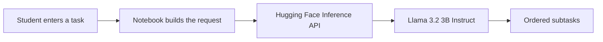

<h1 align="center">📓 AI Academic Task Breaker</h1>

<p align="center">
  <strong>Turn a big academic task into clear, ordered subtasks — using an open LLM</strong>
</p>

<p align="center">
  
  
  
  
</p>

<p align="center">
  <a href="https://colab.research.google.com/github/raghadalb-tech/Ai-academic-task-breaker/blob/main/AI-academicTasksPlanner.ipynb">
    
  </a>
</p>

---

## Overview

Students often get stuck at the start of a large assignment. This notebook takes one academic task in plain language and returns a structured list of smaller subtasks, generated by **Llama 3.2 3B Instruct** through the **Hugging Face Inference API**.

> **Early prototype.** This was my first proof of concept for AI task breakdown. The idea later grew into [**MindTrack**](https://github.com/raghadalb-tech/mindtrack-portfolio), my graduation project: a full Flutter + FastAPI app with Google Gemini, JSON-validated outputs, focus sessions and progress tracking.

---

## How it works



1. Enter your Hugging Face access token.
2. Type an academic task, for example: *"Write a 2,000-word research report on renewable energy."*
3. The model returns clear, structured subtasks.

---

## Run it

**Option 1 — Google Colab (recommended):** click the **Open in Colab** badge above and run the cell.

**Option 2 — locally:**

```bash
pip install huggingface_hub notebook
jupyter notebook AI-academicTasksPlanner.ipynb
```

You need a free [Hugging Face access token](https://huggingface.co/settings/tokens) with access to `meta-llama/Llama-3.2-3B-Instruct`.

---

## Tech stack

| Layer | Stack |
|:---|:---|
| Language | Python |
| Environment | Jupyter Notebook · Google Colab |
| Model | Llama 3.2 3B Instruct |
| Inference | Hugging Face `InferenceClient` (chat completions) |

---

## Security note

The token is entered at runtime and is never stored in the notebook or the repository. Never commit your token.

---

## Author

<p align="center">
  <strong>Raghad Al-Bishri</strong> · Full-Stack Engineer<br/>
  <a href="https://github.com/raghadalb-tech">GitHub</a> · <a href="https://www.linkedin.com/in/raghad-a-53b503395">LinkedIn</a>
</p>
